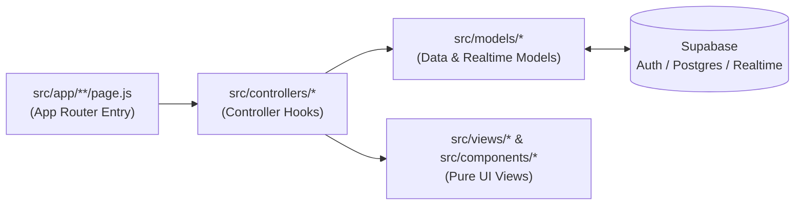
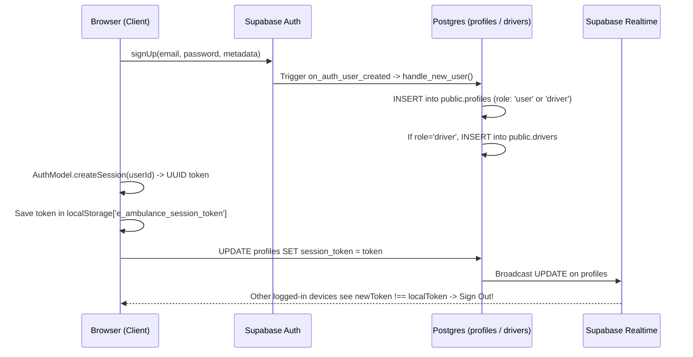
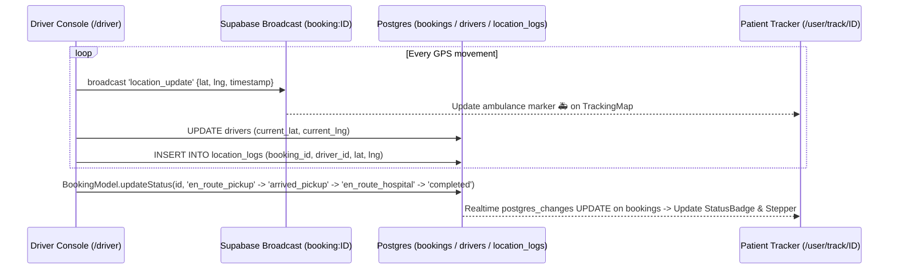

# E-Ambulance — Complete Project & Codebase Guide (Start to End)

This document explains how the **E-Ambulance** platform works from start to finish. It is designed to onboard new developers and collaborators so they can immediately understand the architecture, the end-to-end user/driver/admin workflows, the database schema, and **what every file and function in the repository does**.

---

## Table of Contents

1. [What Is E-Ambulance?](#1-what-is-e-ambulance)
2. [Tech Stack](#2-tech-stack)
3. [MVC Architecture & Directory Structure](#3-mvc-architecture--directory-structure)
4. [How the Project Works from Start to End (Step-by-Step Lifecycle)](#4-how-the-project-works-from-start-to-end-step-by-step-lifecycle)
   - [4.1 Request Entry & Middleware Role Protection](#41-request-entry--middleware-role-protection)
   - [4.2 User Registration, Login & Single-Device Session Enforcement](#42-user-registration-login--single-device-session-enforcement)
   - [4.3 Patient Workflow: Booking an Ambulance (3-Step Wizard)](#43-patient-workflow-booking-an-ambulance-3-step-wizard)
   - [4.4 Driver Workflow: Going Online & Atomically Accepting a Dispatch](#44-driver-workflow-going-online--atomically-accepting-a-dispatch)
   - [4.5 Real-Time GPS Telemetry & Trip Status Progression](#45-real-time-gps-telemetry--trip-status-progression)
   - [4.6 Admin Workflow: Fleet, Hospital & Dispatch Monitoring](#46-admin-workflow-fleet-hospital--dispatch-monitoring)
5. [Database Schema, Triggers & Row-Level Security (`supabase/`)](#5-database-schema-triggers--row-level-security-supabase)
6. [File-by-File & Function-by-Function Reference](#6-file-by-file--function-by-function-reference)
   - [6.1 Infrastructure & Supabase Clients (`src/lib/` & `src/middleware.js`)](#61-infrastructure--supabase-clients-srclib--srcmiddlewarejs)
   - [6.2 Model Layer (`src/models/`) — Database & Domain Logic](#62-model-layer-srcmodels--database--domain-logic)
   - [6.3 Controller Layer (`src/controllers/` & `src/hooks/`) — State & Event Handlers](#63-controller-layer-srccontrollers--srchooks--state--event-handlers)
   - [6.4 View Layer (`src/views/`) — Page Presentation Components](#64-view-layer-srcviews--page-presentation-components)
   - [6.5 Shared UI, Map & Layout Components (`src/components/`)](#65-shared-ui-map--layout-components-srccomponents)
   - [6.6 Next.js App Router Entry Pages (`src/app/`)](#66-nextjs-app-router-entry-pages-srcapp)
7. [Environment Variables & Running Locally](#7-environment-variables--running-locally)

---

## 1. What Is E-Ambulance?

**E-Ambulance** is a 24/7 emergency medical dispatch and real-time ambulance telemetry web application built for **Raiganj, West Bengal**. It connects three distinct actors in real time:

1. **Patient / User (`role = 'user'`)**: Detects their GPS coordinates, picks a destination hospital in Raiganj, dispatches an emergency request, and tracks the assigned ambulance live on Google Maps.
2. **Ambulance Driver (`role = 'driver'`)**: Toggles their shift status (`ONLINE` / `OFFLINE`), receives live incoming emergency requests, accepts dispatches, broadcasts live GPS coordinates every 5 seconds, and updates trip stages from pickup to hospital arrival.
3. **System Administrator (`role = 'admin'`)**: Monitors live system metrics, views and filters all dispatches in real time, manages registered ambulance drivers, and adds/activates/deactivates network hospitals.

---

## 2. Tech Stack

| Layer               | Technology                                           | Purpose                                                                     |
| :------------------ | :--------------------------------------------------- | :-------------------------------------------------------------------------- |
| **Framework**       | Next.js 16.3.4 (App Router) + React 19               | File-system routing, SSR/Client rendering, middleware                       |
| **Database & Auth** | Supabase (`@supabase/supabase-js`, `@supabase/ssr`)  | PostgreSQL database, Row-Level Security (RLS), JWT Auth                     |
| **Real-Time**       | Supabase Realtime (`postgres_changes` + `broadcast`) | Live booking status updates, live GPS streaming, single-device session kick |
| **Maps & Routing**  | Google Maps (`@vis.gl/react-google-maps`)            | Live markers (Patient, Ambulance, Hospital) & driving route polylines       |
| **Styling**         | Tailwind CSS v4 + DaisyUI                            | Dark-themed responsive emergency UI                                         |

---

## 3. MVC Architecture & Directory Structure

The codebase follows a strict **Model–View–Controller (MVC)** pattern so that database queries, application state/business logic, and UI rendering are cleanly separated:



### Folder Breakdown

```text
e-ambulance/
├── src/
│   ├── models/                        # MODEL LAYER: Supabase queries, Realtime channels & domain formulas
│   │   ├── AuthModel.js               # Auth sign-in/up/out, password reset, single-device session tokens
│   │   ├── ProfileModel.js            # CRUD on public.profiles table
│   │   ├── BookingModel.js            # CRUD, atomic driver accept, status machine & Realtime on public.bookings
│   │   ├── DriverModel.js             # CRUD on public.drivers & public.location_logs + GPS broadcast channel
│   │   ├── HospitalModel.js           # CRUD on public.hospitals + Haversine distance formula
│   │   └── index.js                   # Barrel export for all models
│   │
│   ├── controllers/                   # CONTROLLER LAYER: React state, lifecycle orchestration & event handlers
│   │   ├── useAuthController.js       # Session, Login, Register & Reset Password controllers
│   │   ├── useUserController.js       # Patient Dashboard, 3-Step Booking Wizard & Live Tracking controllers
│   │   ├── useDriverController.js     # Driver Console, Pending Feed, GPS Watcher & Trip History controllers
│   │   ├── useAdminController.js      # Admin Dashboard, Live Bookings, Drivers & Hospitals controllers
│   │   └── index.js                   # Barrel export for all controllers
│   │
│   ├── views/                         # VIEW LAYER: Pure presentation components (zero Supabase imports)
│   │   ├── landing/LandingView.js     # Public home page view
│   │   ├── auth/                      # LoginView.js, RegisterView.js, ResetPasswordView.js
│   │   ├── user/                      # UserDashboardView.js, BookAmbulanceView.js, TrackBookingView.js
│   │   ├── driver/                    # DriverDashboardView.js, DriverHistoryView.js
│   │   ├── admin/                     # AdminDashboardView.js, AdminBookingsView.js, AdminDriversView.js, AdminHospitalsView.js
│   │   └── index.js                   # Barrel export for all views
│   │
│   ├── components/                    # SHARED VIEW PARTIALS: Reusable widgets across multiple views
│   │   ├── landing/                   # HeroSection, FleetTypes, HospitalNetwork, HowItWorks, MetricsStrip, etc.
│   │   ├── layout/Navbar.js           # Top navigation bar + SOS 108 emergency button + mobile drawer
│   │   ├── map/TrackingMap.js         # Google Maps wrapper with auto-bounds & driving directions
│   │   └── ui/                        # LoadingSpinner.js, Modal.js, StatusBadge.js, Toast.js
│   │
│   ├── app/                           # NEXT.JS APP ROUTER: Thin route files connecting Controllers to Views
│   │   ├── layout.js                  # Root HTML/Body shell & PWA metadata
│   │   ├── page.js                    # / (Landing page)
│   │   ├── auth/                      # /auth/login, /auth/register, /auth/reset-password
│   │   ├── user/                      # /user, /user/book, /user/track/[bookingId]
│   │   ├── driver/                    # /driver, /driver/history
│   │   └── admin/                     # /admin, /admin/bookings, /admin/drivers, /admin/hospitals
│   │
│   ├── hooks/                         # Browser geolocation hook (useLocation.js) & controller re-exports
│   ├── lib/                           # Supabase clients (client.js, server.js, middleware.js) & constants.js
│   └── middleware.js                  # Next.js request interceptor for auth & role-based routing
│
└── supabase/
    ├── seed.sql                       # Initial seed data for 5 Raiganj hospitals
    └── migrations/                    # SQL schema, RLS policies, triggers & indexes (001 through 004)
```

---

## 4. How the Project Works from Start to End (Step-by-Step Lifecycle)

### 4.1 Request Entry & Middleware Role Protection

Every HTTP navigation request first passes through **`src/middleware.js` → `updateSession()` (`src/lib/supabase/middleware.js`)**:

1. Reads the Supabase Auth cookies from the incoming request and refreshes the session via `supabase.auth.getUser()`.
2. **Unauthenticated check**: If the user is not logged in (`!user`) and tries to visit any route other than `/`, `/auth/login`, `/auth/register`, or `/auth/reset-password`, they are immediately redirected to `/auth/login`.
3. **Role-based guard**: If the user is logged in and visits `/admin/*`, `/driver/*`, or `/user/*`, the middleware queries `public.profiles` for their `role`:
   - A `user` trying to access `/driver` or `/admin` is redirected to `/user`.
   - A `driver` trying to access `/user` or `/admin` is redirected to `/driver`.
   - An `admin` trying to access `/user` or `/driver` is redirected to `/admin`.

---

### 4.2 User Registration, Login & Single-Device Session Enforcement



1. **Registration (`useRegisterController` → `AuthModel.signUp`)**:
   - The user chooses **"Patient / User"** or **"Ambulance Driver"** (which reveals `vehicleNumber` and `vehicleType` inputs).
   - `AuthModel.signUp()` creates the user in `auth.users`.
   - PostgreSQL fires the `on_auth_user_created` trigger (`handle_new_user()`), which automatically inserts a row into `public.profiles` (forcing role to `'user'` or `'driver'` so no one can self-register as `'admin'`) and, if `role = 'driver'`, inserts a row into `public.drivers`.
   - `DriverModel.upsertByProfileId()` also runs idempotently from the client to ensure vehicle details are saved.
2. **Login (`useLoginController` → `AuthModel.signInWithPassword`)**:
   - Authenticates credentials, calls `AuthModel.createSession(user.id)`, fetches the user's role via `ProfileModel.getRoleById()`, and routes them to `/user`, `/driver`, or `/admin`.
3. **Single-Device Session Enforcement (`AuthModel.createSession`, `validateSession`, `subscribeToSessionChanges`)**:
   - On login, a fresh UUID v4 token is written to `localStorage` (`e_ambulance_session_token`) **first**, and then saved to `profiles.session_token` in PostgreSQL.
   - While logged in, `useSessionController` subscribes to `postgres_changes` on `public.profiles` for that user's row.
   - If the same account logs in on a second device/browser, `profiles.session_token` changes in the database. The first device receives the Realtime `UPDATE` event, sees `payload.new.session_token !== localToken`, signs out, and redirects to `/auth/login?kicked=1` with a banner explaining the account was accessed from another device.

---

### 4.3 Patient Workflow: Booking an Ambulance (3-Step Wizard)

When a patient navigates to `/user/book`, **`useBookAmbulanceController`** drives **`BookAmbulanceView`** through 3 steps:

- **Step 1 — GPS Detection**:
  - `useLocation()` requests browser GPS coordinates via `navigator.geolocation.getCurrentPosition`.
  - Once `location` is acquired (or if the user clicks _"Or proceed using Raiganj Center coordinates"_ which sets `manualLocation = CITY_CENTER`), the wizard automatically advances to **Step 2**.
- **Step 2 — Hospital Selection**:
  - `HospitalModel.getActive()` loads all active hospitals from `public.hospitals`.
  - For each hospital, `HospitalModel.calculateDistanceKm(location, hospital)` computes the straight-line Haversine distance in kilometers from the patient's GPS coordinates.
  - The patient can optionally type a custom landmark/pickup address and selects a destination hospital, then clicks **"Continue to Confirmation"**.
- **Step 3 — Confirmation & Dispatch**:
  - `TrackingMap` previews the patient's pickup marker (`P`), destination hospital marker (`H`), and driving route.
  - Clicking **"Confirm Dispatch Request"** calls `useCreateBookingController().createBooking()`:
    1. Calls `BookingModel.hasActiveBooking(user.id)` to verify the patient doesn't already have an ongoing trip (also enforced in Postgres by the partial unique index `idx_unique_active_booking_per_user`).
    2. Calls `BookingModel.create(...)` to insert a new row in `public.bookings` with `status = 'pending'`.
    3. Redirects the patient to `/user/track/[bookingId]`.

---

### 4.4 Driver Workflow: Going Online & Atomically Accepting a Dispatch

When a driver opens `/driver`, **`useDriverDashboardController`** drives **`DriverDashboardView`**:

1. **Online / Offline Toggle (`toggleOnline`)**:
   - Calls `DriverModel.setOnlineStatus(driverData.id, newStatus)` to update `drivers.is_online`.
   - While `isOnline` is `true`, `useDriverLocationController(driverData.id, isOnline)` watches the driver's GPS and updates `drivers.current_lat` and `drivers.current_lng` every 5 seconds.
2. **Live Pending Requests Feed (`usePendingBookingsController`)**:
   - Calls `BookingModel.getPending()` to fetch all bookings where `status = 'pending'`.
   - Subscribes via `BookingModel.subscribeToAllBookings()` to `postgres_changes` on `public.bookings`. Whenever a patient creates or cancels a booking, the driver's pending list refreshes automatically.
3. **Atomic Booking Acceptance (`handleAccept` → `BookingModel.acceptByDriver`)**:
   - When a driver clicks **"Accept Dispatch Request"**:
     1. Verifies the booking still exists and is currently `'pending'`.
     2. Marks the driver as busy (`drivers.is_busy = true`).
     3. Executes a conditional atomic update:
        ```sql
        UPDATE public.bookings
        SET driver_id = <driverId>, status = 'accepted', accepted_at = NOW()
        WHERE id = <bookingId> AND status = 'pending'
        ```
     4. If another driver accepted the booking milliseconds earlier, the `WHERE status = 'pending'` clause matches 0 rows, the losing driver's `is_busy` flag is reverted to `false`, and an error toast (`"Booking already taken by another driver"`) is shown.
     5. If successful, the booking becomes the driver's `activeTrip` and live GPS broadcasting begins (`DriverModel.startLocationBroadcast`).

---

### 4.5 Real-Time GPS Telemetry & Trip Status Progression



Once a booking is accepted, it moves through a strict 6-stage lifecycle defined in `TRIP_STATUS_FLOW` (`src/models/BookingModel.js`):

| Stage # | Status Value        | Patient Label               | Driver Action Button (`getNextDriverAction`) | Map Route Drawn (`TrackingMap`) |
| :-----: | :------------------ | :-------------------------- | :------------------------------------------- | :------------------------------ |
|    1    | `pending`           | Finding Ambulance           | _(Accept Dispatch Request)_                  | Pickup → Hospital               |
|    2    | `accepted`          | Driver Assigned             | **Start Route to Pickup →**                  | Driver (`🚑`) → Pickup (`P`)    |
|    3    | `en_route_pickup`   | Ambulance On the Way        | **Mark Arrived at Pickup →**                 | Driver (`🚑`) → Pickup (`P`)    |
|    4    | `arrived_pickup`    | Ambulance Arrived at Pickup | **Start Route to Hospital →**                | Driver (`🚑`) → Hospital (`H`)  |
|    5    | `en_route_hospital` | Heading to Hospital         | **Complete Trip →**                          | Driver (`🚑`) → Hospital (`H`)  |
|    6    | `completed`         | Trip Complete               | _(Trip Finished — Driver Freed)_             | Summary View                    |

- **When `status` reaches `completed` or `cancelled`**:
  - The driver's GPS broadcast channel is stopped (`broadcastRef.current.stop()`).
  - Both client logic (`DriverModel.setBusyStatus(driverId, false)`) and the PostgreSQL trigger (`sync_driver_busy_state()`) set `drivers.is_busy = false` so the driver can immediately take new emergency calls.

---

### 4.6 Admin Workflow: Fleet, Hospital & Dispatch Monitoring

Administrators have access to four pages under `/admin`:

1. **`/admin` (`useAdminDashboardController`)**: Calls `BookingModel.getAdminDashboardSummary()` to run 7 parallel count/list queries and refreshes every 30 seconds (pausing automatically when the browser tab is hidden via `document.visibilityState`).
2. **`/admin/bookings` (`useAdminBookingsController`)**: Displays the 50 most recent dispatches, supports filtering by status (`all`, `pending`, `accepted`, `completed`, `cancelled`), and subscribes to live `postgres_changes` on `public.bookings`.
3. **`/admin/drivers` (`useAdminDriversController`)**: Lists all drivers with vehicle numbers, types (`basic` / `icu`), phone numbers, busy badges, and allows admins to toggle a driver's `is_online` status.
4. **`/admin/hospitals` (`useAdminHospitalsController`)**: Lists all hospitals with GPS coordinates and provides a modal to add new hospitals, toggle `is_active`, or delete hospitals.

---

## 5. Database Schema, Triggers & Row-Level Security (`supabase/`)

### Tables (`supabase/migrations/001_schema.sql`)

1. **`public.profiles`**
   - Columns: `id` (UUID PK referencing `auth.users`), `full_name`, `phone`, `role` (`'user' | 'driver' | 'admin'`), `avatar_url`, `session_token`, `created_at`.
2. **`public.hospitals`**
   - Columns: `id` (UUID PK), `name` (UNIQUE), `address`, `latitude`, `longitude`, `is_active` (BOOLEAN), `created_at`.
3. **`public.drivers`**
   - Columns: `id` (UUID PK), `profile_id` (UUID UNIQUE FK → `profiles.id`), `vehicle_number`, `vehicle_type` (`'basic' | 'icu'`), `is_online`, `is_busy`, `current_lat`, `current_lng`, `last_location_update`, `created_at`.
4. **`public.bookings`**
   - Columns: `id` (UUID PK), `user_id` (FK → `profiles.id`), `driver_id` (nullable FK → `drivers.id`), `hospital_id` (FK → `hospitals.id`), `pickup_lat`, `pickup_lng`, `pickup_address`, `status` (`'pending' | 'accepted' | 'en_route_pickup' | 'arrived_pickup' | 'en_route_hospital' | 'completed' | 'cancelled'`), `cancel_reason`, `created_at`, `accepted_at`, `completed_at`.
5. **`public.location_logs`**
   - Columns: `id` (UUID PK), `booking_id` (FK → `bookings.id`), `driver_id` (FK → `drivers.id`), `latitude`, `longitude`, `recorded_at`.

### Database Functions & Triggers (`001` – `004` migrations)

| Function / Trigger                                                | Table             | What It Does                                                                                                                                                                                                                                                                          |
| :---------------------------------------------------------------- | :---------------- | :------------------------------------------------------------------------------------------------------------------------------------------------------------------------------------------------------------------------------------------------------------------------------------ |
| `handle_new_user()` (`AFTER INSERT ON auth.users`)                | `auth.users`      | Automatically creates the `public.profiles` row on signup (sanitizing `role` so self-signup can only be `'user'` or `'driver'`), and auto-creates a `public.drivers` row if `role = 'driver'`.                                                                                        |
| `is_admin()`                                                      | Helper            | `SECURITY DEFINER` function that returns `TRUE` if the current `auth.uid()` has `role = 'admin'` in `public.profiles` without triggering infinite RLS recursion.                                                                                                                      |
| `guard_profile_update()` (`BEFORE UPDATE ON profiles`)            | `public.profiles` | Prevents non-admin users from escalating their own `role` column in `public.profiles`.                                                                                                                                                                                                |
| `guard_booking_update()` (`BEFORE UPDATE ON bookings`)            | `public.bookings` | Enforces column-level security: drivers can only modify `status`, `driver_id`, and `accepted_at` (never pickup coordinates or hospital); patients can only transition `status` from `'pending'`/`'accepted'` to `'cancelled'`. Automatically stamps `accepted_at` and `completed_at`. |
| `sync_driver_busy_state()` (`AFTER INSERT OR UPDATE ON bookings`) | `public.bookings` | Automatically sets `drivers.is_busy = TRUE` when a booking enters an active driver state, and resets `drivers.is_busy = FALSE` when a booking is `'completed'` or `'cancelled'`.                                                                                                      |

---

## 6. File-by-File & Function-by-Function Reference

### 6.1 Infrastructure & Supabase Clients (`src/lib/` & `src/middleware.js`)

#### `src/middleware.js`

- **`middleware(request)`**: Next.js entry middleware function. Delegates directly to `updateSession(request)`.
- **`config.matcher`**: Runs middleware on all routes except static assets (`_next/static`, `_next/image`, `favicon.ico`, images).

#### `src/lib/supabase/middleware.js`

- **`updateSession(request)`**:
  - Creates a server-side Supabase client bound to `request.cookies` and `supabaseResponse.cookies`.
  - Calls `supabase.auth.getUser()` to validate the JWT.
  - Redirects unauthenticated visitors away from protected routes to `/auth/login`.
  - Queries `profiles.role` for `/admin/*`, `/driver/*`, and `/user/*` routes and redirects users to their own portal if they try to cross role boundaries.

#### `src/lib/supabase/client.js`

- **`getSupabaseBrowserClient()`**: Returns a singleton browser Supabase client (`createBrowserClient`) initialized with `NEXT_PUBLIC_SUPABASE_URL` and `NEXT_PUBLIC_SUPABASE_ANON_KEY`.

#### `src/lib/supabase/server.js`

- **`getSupabaseServerClient()`**: Async helper for Server Components / Route Handlers that binds `createServerClient` to Next.js `cookies()`.

#### `src/lib/constants.js`

- **`CITY_CENTER`**: Default coordinates for Raiganj (`{ lat: 25.6167, lng: 88.1167 }`).
- **`DEFAULT_ZOOM`**: Default Google Maps zoom level (`13`).
- **`BOOKING_STATUS`**: Enum of the 7 booking statuses (`PENDING`, `ACCEPTED`, `EN_ROUTE_PICKUP`, `ARRIVED_PICKUP`, `EN_ROUTE_HOSPITAL`, `COMPLETED`, `CANCELLED`).
- **`ROLES`**: Enum of user roles (`USER`, `DRIVER`, `ADMIN`).
- **`STATUS_LABELS`**: Human-readable display strings for each status.
- **`LOCATION_UPDATE_INTERVAL`**: GPS polling/broadcast interval (`5000` ms).
- **`HOSPITALS`**: Reference list of the 5 seeded Raiganj hospitals.

#### `src/lib/sessionEnforcer.js` & `src/lib/realtimeTracking.js`

- Thin compatibility adapters that delegate `createSession`, `validateSession`, `clearSession`, `subscribeToSessionChanges` to **`AuthModel`**, and `startLocationBroadcast`, `subscribeToLocationUpdates` to **`DriverModel`**.

---

### 6.2 Model Layer (`src/models/`) — Database & Domain Logic

#### `src/models/ProfileModel.js`

| Function                          | Parameters        | Returns                         | Description                                                                       |
| :-------------------------------- | :---------------- | :------------------------------ | :-------------------------------------------------------------------------------- |
| `ProfileModel.getById`            | `(userId)`        | `{ data, error }`               | Fetches `id, full_name, phone, role, avatar_url, created_at` from `profiles`.     |
| `ProfileModel.getRoleById`        | `(userId)`        | `{ role, error }`               | Fetches only the user's `role` string (defaults to `'user'`).                     |
| `ProfileModel.getSessionToken`    | `(userId)`        | `{ sessionToken, data, error }` | Fetches the current `session_token` from `profiles` for single-device validation. |
| `ProfileModel.updateSessionToken` | `(userId, token)` | `{ error }`                     | Updates `profiles.session_token` with a new UUID token.                           |

#### `src/models/AuthModel.js`

| Function                              | Parameters                                                                 | Returns           | Description                                                                                                                            |
| :------------------------------------ | :------------------------------------------------------------------------- | :---------------- | :------------------------------------------------------------------------------------------------------------------------------------- |
| `AuthModel.signInWithPassword`        | `({ email, password })`                                                    | `{ data, error }` | Signs in a user via `supabase.auth.signInWithPassword`.                                                                                |
| `AuthModel.signUp`                    | `({ email, password, fullName, phone, role, vehicleNumber, vehicleType })` | `{ data, error }` | Registers a new account in Supabase Auth with `raw_user_meta_data`.                                                                    |
| `AuthModel.resetPasswordForEmail`     | `(email, redirectTo)`                                                      | `{ data, error }` | Dispatches a password recovery link to the user's email.                                                                               |
| `AuthModel.signOut`                   | `()`                                                                       | `{ error }`       | Clears the local session token from `localStorage` and signs out of Supabase Auth.                                                     |
| `AuthModel.getCurrentUser`            | `()`                                                                       | `{ user, error }` | Retrieves the currently authenticated user via `supabase.auth.getUser()`.                                                              |
| `AuthModel.onAuthStateChange`         | `(callback)`                                                               | `unsubscribe()`   | Subscribes to `SIGNED_IN` / `SIGNED_OUT` auth events and returns a cleanup function.                                                   |
| `AuthModel.createSession`             | `(userId)`                                                                 | `token \| null`   | Generates a UUID v4 token, saves it to `localStorage` first, and updates `profiles.session_token`.                                     |
| `AuthModel.validateSession`           | `(userId)`                                                                 | `boolean`         | Compares `localStorage` token with `profiles.session_token`. Initializes/adopts token if missing locally.                              |
| `AuthModel.clearLocalSession`         | `()`                                                                       | `void`            | Removes `e_ambulance_session_token` from `window.localStorage`.                                                                        |
| `AuthModel.subscribeToSessionChanges` | `(userId, onKicked)`                                                       | `unsubscribe()`   | Listens for Realtime `UPDATE` events on `profiles` for `userId`; invokes `onKicked()` if `session_token` changes to a different value. |

#### `src/models/HospitalModel.js`

| Function                            | Parameters                                 | Returns            | Description                                                                                                               |
| :---------------------------------- | :----------------------------------------- | :----------------- | :------------------------------------------------------------------------------------------------------------------------ |
| `HospitalModel.getActive`           | `()`                                       | `{ data, error }`  | Fetches all hospitals where `is_active = true`, ordered by `name`.                                                        |
| `HospitalModel.getAll`              | `()`                                       | `{ data, error }`  | Fetches all hospitals (active and inactive) for the Admin portal.                                                         |
| `HospitalModel.getCount`            | `()`                                       | `{ count, error }` | Returns the exact count of hospital records.                                                                              |
| `HospitalModel.create`              | `({ name, address, latitude, longitude })` | `{ data, error }`  | Inserts a new active hospital with parsed float coordinates.                                                              |
| `HospitalModel.toggleActive`        | `(hospitalId, currentActiveState)`         | `{ error }`        | Flips `is_active` to `!currentActiveState` for a hospital.                                                                |
| `HospitalModel.remove`              | `(hospitalId)`                             | `{ error }`        | Deletes a hospital record by ID.                                                                                          |
| `HospitalModel.calculateDistanceKm` | `(userLocation, hospital)`                 | `string \| null`   | Uses the Haversine formula to compute distance in km (formatted to `0.1` km) between user GPS coordinates and a hospital. |

#### `src/models/DriverModel.js`

| Function                                 | Parameters                                       | Returns             | Description                                                                                                                                                                                                        |
| :--------------------------------------- | :----------------------------------------------- | :------------------ | :----------------------------------------------------------------------------------------------------------------------------------------------------------------------------------------------------------------- |
| `DriverModel.getByProfileId`             | `(profileId)`                                    | `{ data, error }`   | Fetches the `drivers` row linked to a user's `profile_id`.                                                                                                                                                         |
| `DriverModel.upsertByProfileId`          | `({ profileId, vehicleNumber, vehicleType })`    | `{ data, error }`   | Idempotently inserts or updates a driver's vehicle record (`ON CONFLICT (profile_id)`).                                                                                                                            |
| `DriverModel.getAllWithProfiles`         | `()`                                             | `{ data, error }`   | Fetches all drivers joined with their `profiles` (`full_name`, `phone`, `role`) for Admin management.                                                                                                              |
| `DriverModel.setOnlineStatus`            | `(driverId, isOnline)`                           | `{ error }`         | Updates `drivers.is_online`.                                                                                                                                                                                       |
| `DriverModel.setBusyStatus`              | `(driverId, isBusy)`                             | `{ error }`         | Updates `drivers.is_busy`.                                                                                                                                                                                         |
| `DriverModel.updateCoordinates`          | `(driverId, lat, lng, timestamp)`                | `{ error }`         | Updates `current_lat`, `current_lng`, and `last_location_update` on `drivers`.                                                                                                                                     |
| `DriverModel.insertLocationLog`          | `({ bookingId, driverId, latitude, longitude })` | `{ error }`         | Appends a GPS breadcrumb row into `public.location_logs`.                                                                                                                                                          |
| `DriverModel.startLocationBroadcast`     | `(bookingId, driverId, intervalMs)`              | `{ stop, channel }` | Starts `navigator.geolocation.watchPosition`, broadcasts `location_update` events on Realtime channel `booking:<bookingId>`, updates `drivers` coordinates, and logs to `location_logs`. Returns `stop()` cleanup. |
| `DriverModel.subscribeToLocationUpdates` | `(bookingId, onLocationUpdate)`                  | `unsubscribe()`     | Subscribes the patient's browser to `booking:<bookingId>` broadcast events and calls `onLocationUpdate(payload)` on each GPS tick.                                                                                 |

#### `src/models/BookingModel.js`

| Function                                | Parameters                                                      | Returns                                | Description                                                                                                                                       |
| :-------------------------------------- | :-------------------------------------------------------------- | :------------------------------------- | :------------------------------------------------------------------------------------------------------------------------------------------------ |
| `BookingModel.getById`                  | `(bookingId)`                                                   | `{ data, error }`                      | Fetches a single booking joined with `hospital`, `driver`, and `driver.profile`.                                                                  |
| `BookingModel.getByUserId`              | `(userId)`                                                      | `{ data, error }`                      | Fetches all bookings for a patient ordered newest-first.                                                                                          |
| `BookingModel.hasActiveBooking`         | `(userId)`                                                      | `{ hasActive, activeBookings, error }` | Checks if the patient currently has any booking in `ACTIVE_BOOKING_STATUSES`.                                                                     |
| `BookingModel.create`                   | `({ userId, hospitalId, pickupLat, pickupLng, pickupAddress })` | `{ data, error }`                      | Inserts a new booking with `status = 'pending'`.                                                                                                  |
| `BookingModel.cancel`                   | `(bookingId, driverId, reason)`                                 | `{ error }`                            | Sets booking `status = 'cancelled'`, records `cancel_reason`, and frees the assigned driver (`setBusyStatus(driverId, false)`).                   |
| `BookingModel.getPending`               | `()`                                                            | `{ data, error }`                      | Fetches all `pending` bookings ordered oldest-first (FIFO queue for drivers), joined with hospital and patient profile.                           |
| `BookingModel.getActiveTripForDriver`   | `(driverId)`                                                    | `{ data, error }`                      | Fetches the driver's currently active assigned trip (`accepted`, `en_route_pickup`, `arrived_pickup`, or `en_route_hospital`).                    |
| `BookingModel.getHistoryForDriver`      | `(driverId)`                                                    | `{ data, error }`                      | Fetches all `completed` and `cancelled` trips for a driver.                                                                                       |
| `BookingModel.acceptByDriver`           | `(bookingId, driverId)`                                         | `{ data, error }`                      | Atomically claims a `pending` booking for `driverId`, sets `status = 'accepted'`, and handles race conditions if another driver claimed it first. |
| `BookingModel.getDriverTripDetails`     | `(bookingId)`                                                   | `{ data, error }`                      | Fetches booking with joined hospital and patient profile for the driver console.                                                                  |
| `BookingModel.updateStatus`             | `(bookingId, newStatus, driverId)`                              | `{ error }`                            | Updates booking `status` and frees `driverId` if the new status is `completed` or `cancelled`.                                                    |
| `BookingModel.getAdminList`             | `({ filter, limit })`                                           | `{ data, error }`                      | Fetches up to `limit` (50) bookings for the Admin portal, optionally filtered by status.                                                          |
| `BookingModel.getAdminDashboardSummary` | `()`                                                            | `{ stats, recentBookings }`            | Runs parallel count queries for total/active/completed bookings, online/total drivers, total hospitals, plus the 10 most recent bookings.         |
| `BookingModel.subscribeToBookingById`   | `(bookingId, onUpdate)`                                         | `unsubscribe()`                        | Subscribes to Realtime `UPDATE` events on `public.bookings` for a specific `bookingId`.                                                           |
| `BookingModel.subscribeToAllBookings`   | `(channelName, onChange)`                                       | `unsubscribe()`                        | Subscribes to all `INSERT`/`UPDATE`/`DELETE` events on `public.bookings`.                                                                         |
| `BookingModel.getNextDriverAction`      | `(status)`                                                      | `{ label, status } \| null`            | Pure state-machine helper returning the next button label and target status for a driver's active trip.                                           |
| `BookingModel.isActiveStatus`           | `(status)`                                                      | `boolean`                              | Returns `true` if status is neither `completed` nor `cancelled`.                                                                                  |
| `BookingModel.canPatientCancel`         | `(status)`                                                      | `boolean`                              | Returns `true` if status is `pending` or `accepted`.                                                                                              |

---

### 6.3 Controller Layer (`src/controllers/` & `src/hooks/`) — State & Event Handlers

#### `src/controllers/useAuthController.js`

- **`useSessionController()`** (also re-exported as `useSession` in `src/hooks/useSession.js`):
  - Initializes auth state on mount, validates single-device session via `AuthModel.validateSession`, loads the user's `profile` and (if driver) `driverData`, and listens for session kick events.
  - Exposes: `{ user, profile, driverData, loading, sessionKicked, signOut, refetchProfile }`.
- **`useLoginController()`**:
  - Manages login form state (`email`, `password`, `loading`, `toast`), reads `?role=` and `?kicked=1` query params, and handles `handleLogin(e)`.
- **`useRegisterController()`**:
  - Manages registration form state (`formData`, `loading`, `toast`), validates password confirmation & minimum length, calls `AuthModel.signUp`, upserts driver info if `role === 'driver'`, and redirects to the appropriate portal.
- **`useResetPasswordController()`**:
  - Manages password recovery form state (`email`, `loading`, `submitted`, `toast`) and calls `AuthModel.resetPasswordForEmail`.

#### `src/controllers/useUserController.js`

- **`useBookingController(bookingId)`** (re-exported as `useBooking` in `src/hooks/useBooking.js`):
  - Fetches a single booking by ID and subscribes to live updates via `BookingModel.subscribeToBookingById`.
- **`useUserBookingsController()`** (re-exported as `useUserBookings`):
  - Fetches the current patient's booking history list.
- **`useCreateBookingController()`** (re-exported as `useCreateBooking`):
  - Exposes `createBooking({ hospitalId, pickupLat, pickupLng, pickupAddress })` with active-booking guard.
- **`useUserDashboardController()`**:
  - Combines `useSessionController` and `useUserBookingsController` to compute `activeBooking` and `quickStats` (`Total Trips`, `Completed`, `Cancelled`, `Active`) for `/user`.
- **`useBookAmbulanceController()`**:
  - Orchestrates the 3-step booking wizard on `/user/book` (`step`, `setStep`, `hospitals`, `selectedHospital`, `pickupAddress`, `effectiveLocation`, `useCityCenterFallback`, `getDistance`, `handleBooking`).
- **`useTrackBookingController(bookingId)`**:
  - Orchestrates `/user/track/[bookingId]`: merges database booking state with live broadcast `driverLocation`, computes step progress (`currentIndex`), normalizes map coordinates (`pickupLocation`, `hospitalLocation`, `activeDriverLocation`), and handles cancellation (`handleCancel`).

#### `src/controllers/useDriverController.js`

- **`usePendingBookingsController()`** (re-exported as `usePendingBookings` in `src/hooks/usePendingBookings.js`):
  - Maintains the live list of `pending` bookings and exposes `acceptBooking(bookingId, driverId)`.
- **`useDriverLocationController(driverId, isActive)`** (re-exported as `useDriverLocation` in `src/hooks/useDriverLocation.js`):
  - Watches browser GPS when `isActive` is `true` and pushes coordinates to `DriverModel.updateCoordinates` every 5 seconds using a stable `locationRef`.
- **`useDriverDashboardController()`**:
  - Orchestrates `/driver`: manages `isOnline`, `activeTrip`, `pendingBookings`, `accepting`, `nextAction`, `toggleOnline()`, `handleAccept(bookingId)`, and `updateTripStatus(newStatus)`. Starts and stops `DriverModel.startLocationBroadcast` automatically.
- **`useDriverHistoryController()`**:
  - Orchestrates `/driver/history`: loads past trips for the current driver and computes `completed` and `cancelled` counts.

#### `src/controllers/useAdminController.js`

- **`useAdminDashboardController()`**:
  - Orchestrates `/admin`: loads `statCards` and `recentBookings`, polling every 30 seconds when the tab is visible.
- **`useAdminBookingsController()`**:
  - Orchestrates `/admin/bookings`: manages status filter tabs (`filter`, `setFilter`, `filters`), fetches filtered bookings, and subscribes to live changes.
- **`useAdminDriversController()`**:
  - Orchestrates `/admin/drivers`: loads all drivers with profiles and provides `toggleOnline(driverId, currentStatus)`.
- **`useAdminHospitalsController()`**:
  - Orchestrates `/admin/hospitals`: manages hospital list, add-hospital modal state (`showAddModal`, `newHospital`, `saving`), `addHospital()`, `toggleActive()`, and `deleteHospital()`.

#### `src/hooks/useLocation.js`

- **`useLocation(options)`**:
  - Browser geolocation hook used by the patient booking wizard.
  - Internal helpers: `requestPosition()` (calls `navigator.geolocation.getCurrentPosition`), `getLocation()` (manual refresh trigger).
  - Exposes: `{ location, error, loading, refresh }`.

---

### 6.4 View Layer (`src/views/`) — Page Presentation Components

All View components are pure UI components that receive state and callbacks as props from their Controller:

| View File                                 | Component Name               | Rendered By Route         | Purpose                                                                                                                                                                                    |
| :---------------------------------------- | :--------------------------- | :------------------------ | :----------------------------------------------------------------------------------------------------------------------------------------------------------------------------------------- |
| `src/views/landing/LandingView.js`        | `LandingView`                | `/`                       | Composes all public landing page sections (`EmergencyTicker`, `LandingHeader`, `HeroSection`, `MetricsStrip`, `HowItWorks`, `FleetTypes`, `HospitalNetwork`, `EmergencyBanner`, `Footer`). |
| `src/views/auth/LoginView.js`             | `LoginView`, `LoginFormView` | `/auth/login`             | Renders the sign-in card, kicked-session alert banner, Patient/Driver portal badge, and login form.                                                                                        |
| `src/views/auth/RegisterView.js`          | `RegisterView`               | `/auth/register`          | Renders account type selector (`Patient / User` vs `Ambulance Driver`), conditional vehicle inputs, and registration form.                                                                 |
| `src/views/auth/ResetPasswordView.js`     | `ResetPasswordView`          | `/auth/reset-password`    | Renders the password reset email form and confirmation message.                                                                                                                            |
| `src/views/user/UserDashboardView.js`     | `UserDashboardView`          | `/user`                   | Renders patient greeting, active trip banner with "Track Live →" button, "Book Ambulance Now" CTA, 4 stat cards, and recent bookings list.                                                 |
| `src/views/user/BookAmbulanceView.js`     | `BookAmbulanceView`          | `/user/book`              | Renders the 3-step progress bar, GPS detection screen, hospital selector with km distances, confirmation summary, and route preview map.                                                   |
| `src/views/user/TrackBookingView.js`      | `TrackBookingView`           | `/user/track/[bookingId]` | Renders live `<TrackingMap />`, assigned driver card with `tel:` call button, 6-step progression indicator, trip details, and cancel confirmation modal.                                   |
| `src/views/driver/DriverDashboardView.js` | `DriverDashboardView`        | `/driver`                 | Renders driver vehicle header, Online/Offline toggle button, active dispatch card with patient `tel:` button and status advancement button, and live pending requests list.                |
| `src/views/driver/DriverHistoryView.js`   | `DriverHistoryView`          | `/driver/history`         | Renders completed/cancelled counters and historical trip cards for the driver.                                                                                                             |
| `src/views/admin/AdminDashboardView.js`   | `AdminDashboardView`         | `/admin`                  | Renders quick navigation buttons, 5 system telemetry stat cards, and the recent 10 dispatches table.                                                                                       |
| `src/views/admin/AdminBookingsView.js`    | `AdminBookingsView`          | `/admin/bookings`         | Renders status filter tabs and the real-time 50-booking table.                                                                                                                             |
| `src/views/admin/AdminDriversView.js`     | `AdminDriversView`           | `/admin/drivers`          | Renders registered driver cards with online/offline status badges, "On Dispatch" indicator, and admin toggle button.                                                                       |
| `src/views/admin/AdminHospitalsView.js`   | `AdminHospitalsView`         | `/admin/hospitals`        | Renders hospital cards, Active/Inactive toggle, Delete button, and the "+ Add Hospital" modal dialog.                                                                                      |

---

### 6.5 Shared UI, Map & Layout Components (`src/components/`)

#### `src/components/layout/Navbar.js`

- **`Navbar()`**: Fixed top navigation bar across all authenticated portals.
  - Always displays the pulsing **`SOS 108`** direct-dial emergency button (`href="tel:108"`).
  - Dynamically renders links based on `profile?.role` (`admin`, `driver`, or `user`).
  - Includes a responsive mobile hamburger menu drawer (`mobileMenuOpen`) and `handleSignOut()`.

#### `src/components/map/TrackingMap.js`

- **`TrackingMap({ pickupLocation, driverLocation, hospitalLocation, height, status })`**:
  - Renders an interactive Google Map via `@vis.gl/react-google-maps` (`<APIProvider>` + `<Map>`).
  - Places markers for Pickup (`P`), Ambulance (`🚑`), and Hospital (`H`).
  - Automatically computes `routeOrigin` and `routeDestination` based on the trip's `status` (Driver → Pickup during `accepted`/`en_route_pickup`; Driver/Pickup → Hospital during `arrived_pickup`/`en_route_hospital`).
  - **Graceful Fallback**: If `NEXT_PUBLIC_GOOGLE_MAPS_API_KEY` is missing or fails to load (`apiError`), renders a clean **Live Telemetry Coordinates** card with a direct **"Open in Google Maps ↗"** deep link (`externalMapsUrl`).
- **`MapBoundsUpdater({ points })`** _(internal helper)_:
  - Uses `useMap()` and `window.google.maps.LatLngBounds` to automatically pan and zoom the map so all active markers fit comfortably in the viewport.
- **`DirectionsPath({ origin, destination })`** _(internal helper)_:
  - Uses `useMapsLibrary('routes')`, `DirectionsService`, and `DirectionsRenderer` to draw a red (`#dc2626`) driving route polyline between `origin` and `destination`.

#### `src/components/ui/`

- **`LoadingSpinner({ size = 'md', text = 'Loading...' })`** (`LoadingSpinner.js`): Renders a spinning red/zinc indicator (`sm`, `md`, or `lg`) with optional caption.
- **`Modal({ isOpen, onClose, title, children })`** (`Modal.js`): Accessible dialog overlay (`role="dialog"`, `aria-modal="true"`) that closes on backdrop click or `Escape` key press.
- **`StatusBadge({ status })`** (`StatusBadge.js`): Color-coded pill badge with a pulsing dot for `pending` (amber), active states (blue), `completed` (emerald), and `cancelled` (zinc).
- **`Toast({ message, type = 'info', onClose, duration = 4000 })`** (`Toast.js`): Floating bottom-right notification banner (`error`, `success`, `warning`, `info`) that auto-dismisses after `duration` ms.

#### `src/components/landing/`

Modular sections rendered on the public home page (`/`):

- `EmergencyTicker.js`: Top 24/7 dispatch status bar with toll-free `108` and `102` dial links.
- `LandingHeader.js`: Sticky landing navigation bar with links to `#how-it-works`, `#fleet`, `#hospitals`, `#emergency`, Driver Portal, Sign In, and Book Ambulance.
- `HeroSection.js`: Main headline, CTAs, trust badges, and live Raiganj fleet radar card.
- `MetricsStrip.js`: 4 key performance highlights (`< 10 Mins`, `25+ Ambulances`, `5+ Network Hospitals`, `24/7/365`).
- `HowItWorks.js`: 3-step visual explanation of the dispatch process.
- `FleetTypes.js`: Breakdown of Basic Life Support (BLS), Advanced Cardiac / ICU, and Patient Transport vehicles.
- `HospitalNetwork.js`: Directory of the 5 connected emergency hospitals in Raiganj with direct booking links.
- `EmergencyBanner.js`: High-contrast emergency callout section.
- `Footer.js`: Multi-column footer with portal shortcuts and emergency contact numbers (`108`, `102`, `100`).

---

### 6.6 Next.js App Router Entry Pages (`src/app/`)

Every route file in `src/app/` is a minimal glue file that connects a **Controller** to a **View**:

| URL Route                 | App Router File                          | Controller Used                | View Rendered                 |
| :------------------------ | :--------------------------------------- | :----------------------------- | :---------------------------- |
| `/`                       | `src/app/page.js`                        | _(Static)_                     | `LandingView`                 |
| `/auth/login`             | `src/app/auth/login/page.js`             | `useLoginController`           | `LoginView` + `LoginFormView` |
| `/auth/register`          | `src/app/auth/register/page.js`          | `useRegisterController`        | `RegisterView`                |
| `/auth/reset-password`    | `src/app/auth/reset-password/page.js`    | `useResetPasswordController`   | `ResetPasswordView`           |
| `/user`                   | `src/app/user/page.js`                   | `useUserDashboardController`   | `UserDashboardView`           |
| `/user/book`              | `src/app/user/book/page.js`              | `useBookAmbulanceController`   | `BookAmbulanceView`           |
| `/user/track/[bookingId]` | `src/app/user/track/[bookingId]/page.js` | `useTrackBookingController`    | `TrackBookingView`            |
| `/driver`                 | `src/app/driver/page.js`                 | `useDriverDashboardController` | `DriverDashboardView`         |
| `/driver/history`         | `src/app/driver/history/page.js`         | `useDriverHistoryController`   | `DriverHistoryView`           |
| `/admin`                  | `src/app/admin/page.js`                  | `useAdminDashboardController`  | `AdminDashboardView`          |
| `/admin/bookings`         | `src/app/admin/bookings/page.js`         | `useAdminBookingsController`   | `AdminBookingsView`           |
| `/admin/drivers`          | `src/app/admin/drivers/page.js`          | `useAdminDriversController`    | `AdminDriversView`            |
| `/admin/hospitals`        | `src/app/admin/hospitals/page.js`        | `useAdminHospitalsController`  | `AdminHospitalsView`          |

Additional special Next.js App Router files in `src/app/`:

- `src/app/layout.js`: Root layout setting dark theme (`dark bg-zinc-950 text-white`), viewport theme color (`#dc2626`), and PWA metadata.
- `src/app/loading.js`: Route-level loading fallback skeleton.
- `src/app/error.js`: Client-side error boundary with a "Try Again" recovery button.
- `src/app/not-found.js`: Custom 404 page with navigation back to `/`.
- `src/app/manifest.js`: Generates `/manifest.webmanifest` for mobile PWA installation.

---

## 7. Environment Variables & Running Locally

### Required Environment Variables (`.env.local`)

```env
NEXT_PUBLIC_SUPABASE_URL=https://<your-project-ref>.supabase.co
NEXT_PUBLIC_SUPABASE_ANON_KEY=<your-supabase-anon-key>
NEXT_PUBLIC_GOOGLE_MAPS_API_KEY=<your-google-maps-js-api-key>
```

### Database Setup

Run the SQL files in `supabase/migrations/` in order (`001` → `002` → `003` → `004`) followed by `supabase/seed.sql` in the Supabase SQL Editor.

### Running the App

```bash
# Start development server
npm run dev

# Run ESLint check
npm run lint

# Build for production
npm run build
```
